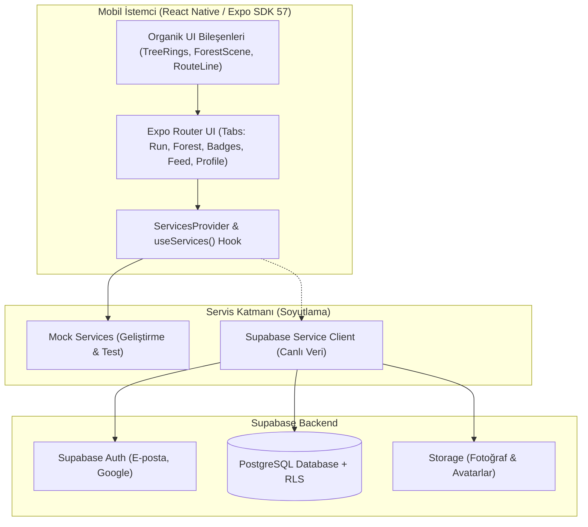

# 🌲 4Tree

> **"Attığın her adım, koştuğun her kilometre gerçek bir ormana dönüşsün."**

<p align="center">
  
  
  
  
  
</p>

---

## 📌 Genel Bakış

**4Tree**, kullanıcıların koşu ve yürüyüş yaparak doğaya somut katkı sağladığı yeni nesil bir mobil sağlık ve sürdürülebilirlik uygulamasıdır. 

Uygulamanın temel kuralı yalın ve şeffaftır:
$$\mathbf{20\text{ km} = 1\text{ Gerçek Ağaç}}$$

Kullanıcıların katettiği mesafeler anlaşmalı sivil toplum kuruluşları (**TEMA**, **Eden Reforestation Projects** vb.) iş birliğiyle gerçek fidanlara dönüştürülür. Kullanıcılar kaç fidan dikilmesini sağladıklarını, fidanların dikim bölgelerini ve CO₂ dengeleme etkilerini uygulama içinden şeffaf biçimde takip eder.

---

## 🎨 Tasarım Felsefesi (v2 Organic Design)

4Tree, standart spor uygulamalarının soğuk neon-siyah şablonlarından ve yapay zekâ klişesi kart yığınlarından bilinçli olarak uzaklaşmıştır:

* **🪵 Dendrokronoloji (Ağaç Halkası) İmzası:** Her koşu bir ağacın gövdesinde yeni bir halka oluşturur. 20 km'lik ilerleme, elle çizilmiş gibi dalgalı ve organik iç içe halkalar olarak canlanır.
* **🌲 Gece Ormanı Paleti:** Saf siyah yerine gece ormanı (`#0C1713`), çam (`#13251D`), yosun (`#1D372B`), huş ağacı beyazı (`#EEE9DA`) ve kehribar sarısı (`#E3A857`).
* **✍️ Karakterli Tipografi:**
  * **Başlıklar & Rakamlar:** `Bricolage Grotesque` — Sıcak, hafif tuhaf ve karakterli grotesk.
  * **Gövde Metinleri:** `Figtree` — Temiz, yuvarlak hatlı ve yüksek okunurluklu.
* **📮 Filateli & Arazi Defteri Ruhu:** Başarımlar jenerik oyun rozetleri değil; posta pulları, damgalar ve arazi pasaportu konseptiyle tasarlanmıştır.

---

## ✨ Temel Özellikler

| Modül | Açıklama |
|---|---|
| 🏃 **Aktivite & Koşu** | GPS ve Adımsayar destekli koşu/yürüyüş takibi. Ana ekranda canlı ağaç halkası ilerlemesi, tempo, süre ve mesafe sayaçları. |
| 🌳 **Kişisel Orman** | Katmanlı tepeler, gün batımı ışığı ve SVG tabanlı dinamik ağaç sahnesi. Toplam dikilen ağaç, CO₂ dengeleme ve dikim bölgesi kartları. |
| 🎖️ **Başarımlar & Pullar** | Posta pulu estetiğinde seviye rozetleri (*Tohum > Fidan > Ağaç > Orman*), mühürler ve kazanım tarihçesi. |
| 🌊 **Sosyal Akış (Feed)** | Topluluk koşuları, rota kontur çizgileri, *"Su Ver" 💧* ve *"Alkışla" 👏* tepkileri. |
| 🛡️ **Gizlilik Bölgeleri** | Ev/iş gibi hassas konumların etrafında yarıçap bazlı akıllı gizlilik bölgesi (Privacy Zone) rota kırpması. |

---

## 🏛️ Mimari & Sistem Şeması



### 🧩 Servis Katmanı & Bağımsız Geliştirme
Mobil arayüz, backend'den tamamen bağımsız çalışabilecek şekilde **Servis Sağlayıcı (Provider)** deseniyle kurgulanmıştır:
- `createMockServices({ scenario: 'default' | 'empty' | 'error' })` ile internet bağlantısı olmadan veya backend hazır olmadan tüm senaryolar test edilebilir.
- Supabase entegrasyonu tamamlandığında tek bir provider değişimiyle tüm uygulama canlı sunucuya bağlanır.

---

## 🗄️ Veritabanı Şeması (Supabase / PostgreSQL)

Proje veritabanı şeması ve migrasyonları [`supabase/migrations/`](file:///Users/cem/Projects/4Tree/supabase/migrations) altında yer alır:

- **`users_profile`:** Kullanıcı bilgileri, aktif günler, toplam mesafe, seviye ve görünürlük ayarı.
- **`runs`:** GPS rota noktaları, mesafe, süre, tempo, aktivite türü (`run` / `walk`) ve kazanılan tohumlar.
- **`user_trees`:** Kazanılan ağaçlar, dikim STK'sı, dikim bölgesi ve sertifika bilgisi.
- **`badges` & `user_badges`:** Başarım tanımları ve kullanıcı kazanımları.
- **`posts`, `post_reactions`, `comments`:** Sosyal akış ve idempotent tepkiler (`clap`, `water`).
- **`privacy_zones`:** Kullanıcının gizlediği koordinatlar ve güvenlik yarıçapları.
- **`friendships`:** Karşılıklı arkadaşlık ilişkileri.
- 🔒 **Row-Level Security (RLS):** Tüm tablolarda kullanıcı bazlı güvenli veri erişim politikaları.

---

## 📂 Klasör Yapısı

```bash
4Tree/
├── architecture.md           # Sistem mimarisi ve karar günlüğü
├── README.md                 # Proje tanıtımı ve kılavuz
├── mobile/                   # Expo React Native mobil uygulaması
│   ├── src/
│   │   ├── app/              # expo-router sekme ve sayfa yönlendirmeleri
│   │   ├── components/       # Ortak UI ve illüstrasyon bileşenleri
│   │   │   └── illustration/ # TreeRings, Tree, ForestScene (SVG + Reanimated)
│   │   ├── features/         # Özellik modülleri (run, forest, achievements, feed, profile)
│   │   ├── services/         # Servis arayüzleri, dönüşüm fonksiyonları ve mock'lar
│   │   ├── theme/            # Renk token'ları, tipografi ve boşluk kuralları
│   │   ├── types/            # TypeScript tip tanımları
│   │   └── i18n/             # Türkçe metin ve yerelleştirme sözlüğü
│   ├── DESIGN.md             # v2 Tasarım dili rehberi
│   └── package.json
└── supabase/
    └── migrations/           # PostgreSQL şema ve RLS migrasyonları
```

---

## 🚀 Başlarken

### Gereksinimler
- **Node.js:** v18.0.0 veya üzeri
- **npm** veya **yarn**
- **Expo Go** uygulaması (fiziksel test için iOS veya Android cihazınızda)

### 1. Depoyu Klonlayın
```bash
git clone https://github.com/eneskaraoglan/4Tree.git
cd 4Tree
```

### 2. Mobil Uygulamayı Kurun & Çalıştırın
```bash
cd mobile
npm install

# Geliştirme sunucusunu başlatın
npm run start
```

Terminalde beliren QR kodu **Expo Go** (Android) veya Kamera uygulaması (iOS) ile tarayarak uygulamayı anında cihazınızda test edebilirsiniz.

Platform bazlı doğrudan başlatmak için:
```bash
npm run ios       # iOS Simülatörü
npm run android   # Android Emülatörü
npm run web       # Web tarayıcısı
```

### 3. Testleri ve Tip Kontrolünü Çalıştırın
```bash
npm run test       # Jest birim testleri
npm run typecheck  # TypeScript statik tip kontrolü
npm run lint       # ESLint kontrolü
```

---

## 🎨 Tasarım Sistemi Token'ları

| Token | Değer | İsim | Kullanım Alanı |
|---|---|---|---|
| `canvas` | `#0C1713` | Gece Ormanı | Uygulama zemin rengi |
| `surface` | `#13251D` | Çam | Kartlar, sheet'ler |
| `surface2` | `#1D372B` | Yosun | İkincil yüzeyler, form girdileri |
| `primary` | `#8DBF6A` | Yaprak Yeşili | Ana butonlar, aktif sekme, halka ilerlemesi |
| `text` | `#EEE9DA` | Huş Beyazı | Birincil metinler |
| `textSecondary` | `#A9B8A8` | Adaçayı | İkincil metinler |
| `gold` | `#E3A857` | Kehribar | Rozetler, seviye ve güneş vurguları |
| `bark` | `#A8754B` | Ağaç Gövdesi | Halka çizgileri, organik hatlar |
| `water` | `#7FB7C9` | Dere Mavisi | "Su Ver" sosyal etkileşimi |

---

## 🤝 Katkıda Bulunma

1. Bu depoyu çatallayın (Fork).
2. Yeni bir özellik dalı oluşturun (`git checkout -b feature/yeni-ozellik`).
3. Değişikliklerinizi commit edin (`git commit -m 'feat: yeni özellik eklendi'`).
4. Dalınıza push yapın (`git push origin feature/yeni-ozellik`).
5. Bir **Pull Request** açın.

---

<p align="center">
  Daha yeşil bir dünya için adım at. 🌱 <b>4Tree Ekibi</b>
</p>
